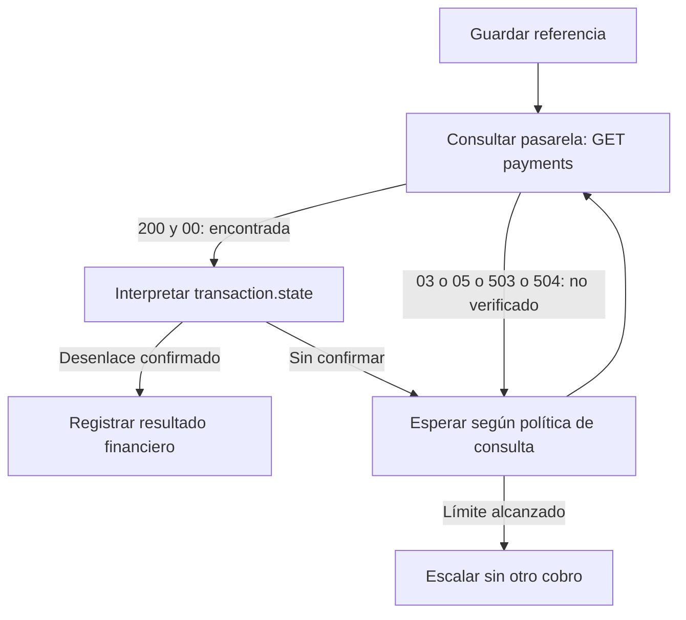

## Secuencia por método

| Método | Secuencia normal |
| --- | --- |
| CARD | Autorizar → solicitar tarjeta y PIN cuando corresponda → procesar → confirmar resultado. |
| QR | Autorizar → generar QR y transacción pendiente → esperar confirmación de pago → confirmar resultado. |

El POST espera un resultado hasta agotar su tiempo de espera. La transacción QR existe desde que se genera el código. Consulta los [diagramas CARD y QR](/procesamiento-fisico/alignet-transit/cancelacion).

## Después de cancelar

Para ambos métodos, el PinPAD corta el flujo visual cuando recibe y procesa `/cancel`. Si falla la conexión, no puedes asegurar recepción ni cierre visual. Reconoce la cancelación confirmada y validada en la respuesta del POST. Ante fallo, timeout o incertidumbre, consulta el cobro original con `GET /payments/{operationNumber}`. Un cobro CARD aprobado permite evaluar un extorno independiente. Si QR aparece `transaction.state: "AUTORIZADO"` en una consulta `200/00` después de solicitar cancelación, conserva el pago aprobado y registra la discrepancia; no solicites refund ni reversa. Aplica la [tabla de resolución](/procesamiento-fisico/alignet-transit/cancelacion#verificar-el-resultado-final).

En QR, la cancelación solo inhabilita el código; ni `/cancel` ni refund devuelven un monto pagado. Ante timeout, desconexión o fallo del backend, el frontend muestra **Cancelación no confirmada** y consulta el estado.

Sin solicitud de cancelación, un QR `transaction.state: "AUTORIZADO"` en una consulta `200/00` confirma el pago y permite ejecutar la acción de negocio. Los ciclos de consulta repiten únicamente el GET; no reenvían `/cancel`.

No inicies una nueva transacción mientras la anterior siga sin resolverse. Un `202 WAITING_RESULT` tardío de `/authorize` no reemplaza un resultado final confirmado.

## Timeouts

Los POST de autorización, cancelación y extorno esperan al PinPAD aproximadamente **90 segundos**, según la guía 1.3.25. Configura un timeout superior y valida la duración en tu ambiente.

Configura el timeout de lectura del cliente HTTP por encima de la espera del terminal:

```text
Espera aproximada de los POST: 90 s
Timeout HTTP del sistema central: al menos 100–110 s
```

`GET /payments` puede esperar aproximadamente 12–15 segundos por la pasarela; usa, por ejemplo, 20 segundos de timeout. `GET /health` y `GET /reversals` responden inmediatamente. Todas las respuestas incluyen `Connection: close`: abre una conexión por petición, sin keep-alive.

Un cobro puede tomar decenas de segundos. No uses el mismo timeout corto que aplicarías a una API convencional.

<Warning>
  Si el timeout del sistema central vence antes que el del terminal, el pago puede continuar aunque el comercio haya perdido la conexión. Un timeout de red nunca equivale a rechazo.
</Warning>

El valor definitivo de la espera interna, el timeout del sistema central y el tiempo máximo de recuperación deben validarse con Alignet antes de producción.

## Recuperación de una operación incierta

Usa `GET /payments/{operationNumber}` para consultar el cobro original **en la pasarela**. Devuelve `success`, `resultCode`, `resultMessage` y `transaction`, sin `status` propio; `00` indica encontrada y el desenlace financiero se lee en `transaction.state`. No existe consulta de cancelación. Para un extorno CARD, usa `GET /reversals/{operationNumber}`; HTTP `502 UNKNOWN` termina esa solicitud sin confirmar éxito y requiere revisión financiera.

Consulta cuando ocurra cualquiera de estos casos:

- `POST /authorize` devuelve HTTP `202` con `WAITING_RESULT` y `result: null`;
- el timeout del cliente HTTP vence sin recibir respuesta;
- la conexión se interrumpe durante el cobro;
- el sistema central se reinicia con una operación abierta;
- la consulta no verifica el cobro (`200/03`, `404/05`, `503` o `504`) o su estado financiero no permite concluir.



Procedimiento:

1. Conserva el `operationNumber` original.
2. Mantén la operación como no resuelta en el sistema central.
3. No ejecutes la acción de negocio asociada ni marques un rechazo definitivo.
4. Ejecuta `GET /payments/{operationNumber}`.
5. Si el POST previo devolvió `202`, respeta `Retry-After: 2` antes del primer GET. Este GET no devuelve `202`; interpreta su [tabla HTTP](/procesamiento-fisico/alignet-transit/respuesta-estados-y-codigos#consulta-de-estado).
6. Sigue consultando hasta conocer el resultado del cobro o alcanzar el límite de espera acordado.
7. Si alcanzas ese límite sin verificar el resultado financiero, escala la operación para resolución. No inicies automáticamente otro cobro.

## Idempotencia

`operationNumber` es la clave de idempotencia del cobro. Esta tabla aplica a `/authorize`; el [extorno](/procesamiento-fisico/alignet-transit/extorno#recuperaci%C3%B3n-e-idempotencia) permite otro intento tras `DENIED`, `UNKNOWN` o `ERROR` finales.

| Escenario | Comportamiento garantizado |
| --- | --- |
| Misma referencia mientras se procesa | No se inicia un segundo cobro. Pay-me PinPAD responde HTTP `202` sin iniciar otro cargo; interpreta `WAITING_RESULT` y `result: null`. |
| Misma referencia ya finalizada | No se inicia un segundo cobro. Pay-me PinPAD responde HTTP `200` con el resultado almacenado. |
| Resultado perdido por el sistema central | El sistema central puede consultar o reenviar la misma referencia para recuperar el resultado existente. |
| Nueva operación real | El sistema central debe generar una referencia nueva. |

```text
1 operación real de cobro = 1 operationNumber
```

No cambies el monto ni la moneda al reutilizar una referencia. El contrato vigente no documenta el comportamiento para una misma referencia con un payload diferente; evita esa condición y escálala si ocurre.

## Concurrencia

Pay-me PinPAD procesa una sola operación a la vez:

- Si llega el mismo `operationNumber`, aplica la regla de idempotencia.
- Si llega otro `operationNumber` mientras existe un cobro activo, responde HTTP `409` con `POS_BUSY`.
- El sistema central debe serializar los cobros destinados al mismo terminal.
- Después de `POS_BUSY`, espera a que el terminal se libere antes de reintentar la solicitud que no fue aceptada.

Si varios procesos pueden enviar pagos al mismo Wiseasy P5L, coordínalos mediante una cola o bloqueo único en el sistema central.

## Reinicios

### Reinicio del sistema central

Al iniciar, recupera las operaciones guardadas cuyo resultado aún no conoces y consulta cada `operationNumber` antes de decidir si hubo cobro.

### Reinicio del Wiseasy P5L durante el cobro

El resultado del cobro puede quedar sin verificar. La guía no define un estado de respuesta específico para el reinicio. No marques la operación como aprobada ni rechazada. Consulta la referencia y solicita revisión si no logras conocer el resultado dentro del límite de espera acordado.

## Flujo recomendado del sistema central

```text
1. GET /health para confirmar disponibilidad.
2. Generar y persistir un operationNumber único.
3. POST /authorize con timeout de al menos 100–110 s.
4. Evaluar HTTP, success, resultCode y result.state.
5. Confirmar autorización con 200 + success true + 00 + AUTORIZADO.
   En consulta 200/00, leer transaction.state; 00 solo significa encontrada.
   Reconocer cancelación validada en la respuesta de POST /cancel.
   Si falla y el cobro CARD está aprobado, evaluar un extorno independiente.
   Conservar QR aprobado sin refund ni reversa; registrar la discrepancia.
6. Ante 202, timeout o desconexión, consultar la referencia original.
7. Iniciar otro cobro solo después de confirmar el desenlace financiero anterior,
   con un operationNumber nuevo y después de la decisión del usuario.
```

## Decisión de negocio

Define antes de producción qué hará el comercio cuando todavía no sabe si se cobró. No confirmes la venta ni ejecutes una acción irreversible —por ejemplo, abrir una barrera— hasta confirmar `success: true`, `resultCode: "00"` y `result.state: "AUTORIZADO"` en autorización, o una consulta `200/00` con `transaction.state: "AUTORIZADO"`.

La política para operaciones sin verificar, incluido el escalamiento manual, requiere acuerdo entre el integrador y Alignet.

## Persistencia mínima

Guarda, cuando existan:

```text
operationNumber
amount
currency
paymentMethod
tollData
additionalFields
código HTTP
success y result.state (autorización)
success y transaction.state (consulta a pasarela)
status (cancelación y extorno)
resultCode y resultMessage, o message en extorno 502 UNKNOWN
identificador de transacción y código de autorización, cuando existan
completedAt (cancelación o extorno, cuando exista)
fecha y hora de cada solicitud y respuesta
```

No almacenes datos sensibles de tarjeta.

Conserva por separado los eventos de cancelación, la autorización original y cualquier extorno explícito. Guarda su estado y marcas de tiempo para evitar decisiones basadas en una respuesta anterior.
